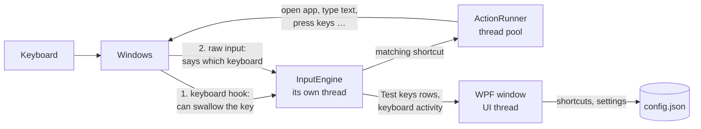

# How KeyLayer works

A guide for anyone who wants to read or change the code. KeyLayer is a small C# / .NET app (about 5,800 lines,
no libraries beyond .NET itself). Most of it is plain UI code; the interesting part is how it watches the keyboard,
because Windows makes that harder than it looks.

## The big picture

- **`App`** owns everything: the tray icon, the settings, the input engine and the window. The window is only built
  while it's open, so the tray app stays at a few MB.
- **`InputEngine`** runs on its own thread with a message loop. Every key press goes through it. Keeping it off the
  UI thread means a busy window can never make typing lag.
- **`ActionRunner`** carries out a shortcut's action on a thread-pool thread, never on the input thread.
- **`MainWindow`** and **`ShortcutEditor`** are the UI (WPF with the Windows 11 look).

## Where things are

| File | What's in it |
|---|---|
| `Program.cs`, `App.xaml.cs` | Start-up, one-copy-only, tray icon, start with Windows, freeing memory when the window closes |
| `Models.cs` | Shortcuts, triggers, actions and the settings file (`%APPDATA%\KeyLayer\config.json`) |
| `InputEngine.cs` | The engine's state, its thread and message loop, timers, diagnostics |
| `InputEngine.Keys.cs` | The keyboard hook: deciding what happens to each key press |
| `InputEngine.RawInput.cs` | Raw input: which keyboard a key came from; keys while KeyLayer's own window is active |
| `InputEngine.Signals.cs` | Media/launch/vendor HID signals, and matching them to the keys Windows makes from them |
| `InputEngine.Keyboards.cs` | Finding keyboards, the built-in keyboard, receivers |
| `InputEngine.Capture.cs` | Capturing a key in the shortcut editor |
| `InputEngine.Holding.cs` | "Act as another key" and "repeat while held" |
| `InputEngine.Apps.cs` | Apps where shortcuts are off |
| `InputEngine.TestKeys.cs` | Rows for the Test keys page |
| `HidDevice.cs` | Reading HID devices and decoding their reports; keyboard IDs (`VID:PID`) |
| `InputSender.cs` | Sending keys and text (`SendInput`), holding keys, pasting |
| `ActionRunner.cs` | Running actions: open, press keys, type, media, brightness, commands … |
| `ClashCheck.cs` | Does a key clash with shortcuts Windows or apps use? |
| `Apps.cs` | Which program a window belongs to (including store apps), open apps for the picker |
| `KeyNames.cs` | Names for keys and HID usages, modifier flags, the KeyLayer Fn key |
| `Native.cs` | Windows API declarations |
| `MainWindow.*`, `ShortcutEditor.*`, `AppList.*`, `AppPicker.*`, `Theme.xaml`, `ViewModels.cs` | The UI |
| `installer/` | The Inno Setup installer and the script that draws its artwork |

## The journey of a key press

1. **The keyboard hook** (`HookCallback` → `OnKeyDown` / `OnKeyUp`) sees the key first, before any app does. It works
   out which modifiers are held (and whether the KeyLayer Fn key is), and `Decide` looks for a shortcut.
2. If a shortcut matches, the key is **swallowed** (unless the shortcut says the key keeps its normal job) and the
   action is handed to `ActionRunner`.
3. **Raw input** (`OnRawInput`) arrives a moment later for keys the hook let through, naming the keyboard. It also
   carries **HID signals** (`OnHidReport`): media, launch and vendor keys, many of which Windows ignores.
4. Keys KeyLayer sends itself are tagged (`InputSender.Marker`) so the hook lets them pass and never treats them as
   shortcuts.

## The Windows quirks it works around

These are the reasons the engine isn't just "look up the key, run the action".

### 1. The hook doesn't know which keyboard a key came from

Only raw input says which keyboard sent a key, and it arrives *after* the hook has to decide. Worse, a key-down the
hook swallows is never reported by raw input at all. So for a shortcut limited to one keyboard:

- **Media and launch keys** (volume, Mail …) also send a HID signal that names the keyboard. The key is held for up
  to 250 ms until that signal arrives (`Deferred`, `ResolveDeferred`).
- **Ordinary keys** are held back, and their *release* is let through, because Windows does name the keyboard for the
  release (`ReleaseWait`, `ResolveRelease`). That's why such shortcuts run when you let go of the key.

Either way, if it was a different keyboard, the key is replayed so it does its normal job.

### 2. The hook is skipped while KeyLayer's own window is active

Windows doesn't call a process's keyboard hook while that process's own window is in front, if the process also
listens to raw keyboard input (which KeyLayer must). So while a KeyLayer window is active, keys are read from raw
input instead (`OnRawKeyInForeground`). They can't be swallowed there, and the shortcut editor turns shortcuts off
while it's open. Whenever KeyLayer's window gains or loses focus, held keys are reset so nothing stays stuck.

### 3. The keyboard's own Fn key is invisible

Keyboards handle Fn themselves. Fn + a key with a special job sends that job as a signal (which KeyLayer catches);
Fn + an ordinary key arrives as just that key. Nothing tells Windows about Fn itself. Hence the **KeyLayer Fn key**
(Caps Lock, Right Ctrl …): held, it adds a `Fn` flag to the next key; tapped alone, it's replayed so it does its
normal job.

### 4. Windows can drop the hook without telling

If a hook ever takes too long to answer, Windows silently removes it. KeyLayer notices when real key presses arrive
through raw input that the hook never saw, and installs the hook again (`InstallHook`). It also does this after sleep
and unlocking.

### Smaller ones

- **Keys sent while you hold a modifier.** Sending text means lifting held Ctrl/Shift first, and Windows then thinks
  they're up. KeyLayer tracks which modifiers your fingers are really on and presses them back down afterwards.
- **Store apps** (Calculator, Photos …) all run inside one Windows program. `Apps.ExePathOf` looks inside its window
  to find the real app.
- **Media keys arrive twice**: as a HID signal and as a key Windows makes from it. The Test keys page merges them into
  one row.

## Staying light

- The engine sleeps until a key arrives: no timers run while idle (about 0% CPU), and handling a key press costs
  well under a millisecond.
- The window is drawn without the GPU (software rendering), so the graphics driver never loads into KeyLayer.
- The window is built when opened and freed when closed, and unused memory is handed back to Windows. In the tray
  KeyLayer uses a few MB.

## Testing

The scripts in [`tests/`](../tests) drive a real KeyLayer with simulated key presses and real windows, and check what
happens. See [`tests/README.md`](../tests/README.md). GitHub Actions builds every push, checks the app starts, and
installs and uninstalls it.
